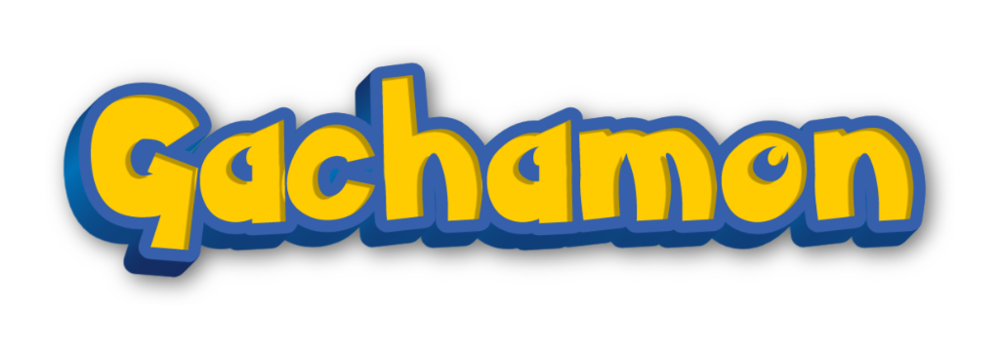

# Gachamon



Gachamon es una aplicación móvil de colección inspirada en los juegos de Pokémon. Usa una máquina gacha 3D para obtener Pokémon de la primera generación, guardarlos en la Pokédex y descubrirlos por rareza.

## Funciones

- Máquina gacha 3D interactiva: toca la ranura para insertar una moneda y comenzar una tirada.
- Animación de la máquina, apertura de la Poké Ball y revelación del Pokémon.
- Pokédex con filtros por rareza y opción para mostrar solo los Pokémon capturados.
- Colección y energía guardadas localmente en el dispositivo.
- Energía que se regenera con el tiempo: máximo de 20 puntos, 2 por tirada y 1 punto cada 5 minutos.
- Probabilidades de rareza configuradas en 70 % común, 20 % rara, 8 % épica y 2 % legendaria.
- Datos e imágenes de Pokémon obtenidos desde [PokéAPI](https://pokeapi.co/).

## Requisitos

- Node.js 22.13 o posterior.
- npm.
- Expo Go para ejecutar la aplicación en un dispositivo, o un emulador Android/iOS.

## Instalación y ejecución

Desde la carpeta del proyecto, instala las dependencias y arranca Expo:

```bash
npm ci
npm run start
```

Escanea el código QR con Expo Go o abre el proyecto en un emulador. También puedes usar los comandos directos:

```bash
npm run android
npm run ios
npm run web
```

## Comprobaciones

Ejecuta las pruebas automatizadas y el chequeo de TypeScript:

```bash
npm test
npx tsc --noEmit
```

## Estructura del proyecto

```text
src/
├── core/          # Ensamblado de dependencias
├── data/          # PokéAPI, almacenamiento local y repositorios
├── domain/        # Reglas de gacha, energía, colección y casos de uso
├── presentation/  # Pantallas, navegación y estado de la interfaz
├── shared/        # Tema y utilidades compartidas
└── three/         # Escena 3D, máquina y animaciones
__tests__/         # Pruebas de dominio, datos, presentación y escena
assets/            # Logo e iconos de la aplicación
```

La aplicación está construida con Expo SDK 57, React Native, TypeScript, Three.js y React Three Fiber. La navegación actual usa una barra de dos pestañas propia. La escena 3D se encuentra en `src/three` y la configuración de probabilidades, rarezas y energía en `src/domain`.
